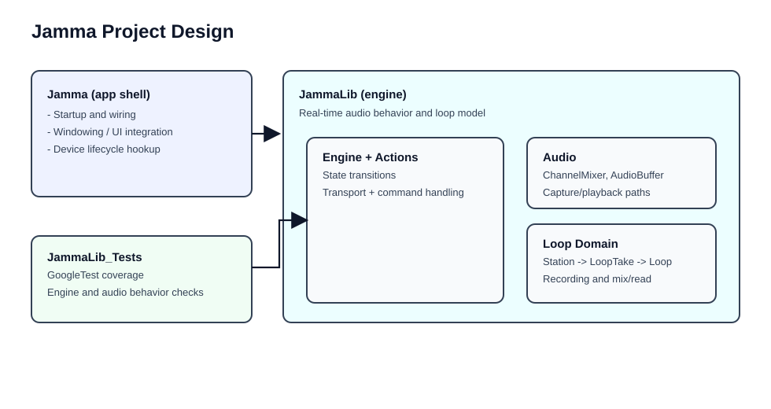
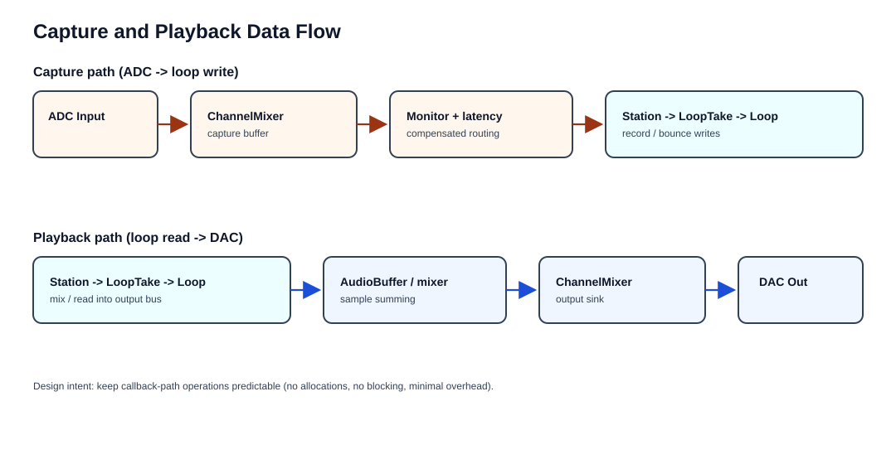

# Jamma Documentation

## Developer Resources

- [Build and Test Guide](build.md)
- [Performance Console](performance-console.md)
- [Real-Time Audio Guidance](realtime-audio.md)
- [Jamma Concepts and Glossary](glossary.md)
- [Loop Grid Editor](loop-grid-editor.md)
- [Multi-Device MIDI Trigger Rig Configuration](midi-trigger-mapping.md)
- [Ninjam Integration Guide](ninjam.md)
- [VS Code Tasks Starter](vscode-tasks.example.json)

## Project Structure

- `Jamma`: Application shell, startup, and top-level wiring.
- `JammaLib`: Engine, loop model, audio behavior, rendering/audio support layers, and domain-specific orchestration collaborators.
- `test/JammaLib_Tests`: Native GoogleTest coverage for engine/audio behavior.

## Core Domain Model

The looping model is hierarchical:

- `Scene`: Session composition, subsystem lifecycle, and cross-subsystem coordination.
- `Station`: Top-level performance/mixing channel and coordination.
- `LoopTake`: A take/layer grouping within a station.
- `Loop`: Underlying sample data and playback/record behavior.

`Scene` coordinates these owners without taking over their audio-block,
per-entity, or persistence responsibilities. The [glossary](glossary.md)
defines the ownership boundaries and terms used throughout the codebase.

## High-Level Architecture

Notes:

- The app project (`Jamma`) should stay thin and delegate engine behavior to `JammaLib`.
- Tests target `JammaLib` behavior directly for fast feedback and minimal UI coupling.

## Audio Signal Flow

Capture path:

1. ADC input enters the mixer capture buffer.
2. Monitor and latency-compensated routing are applied.
3. Samples are written into `Station -> LoopTake -> Loop`.

Playback path:

1. Loop model reads/mixes content for output.
2. Audio data is accumulated through buffer/mixer stages.
3. Channel mixer sends final output to DAC.

